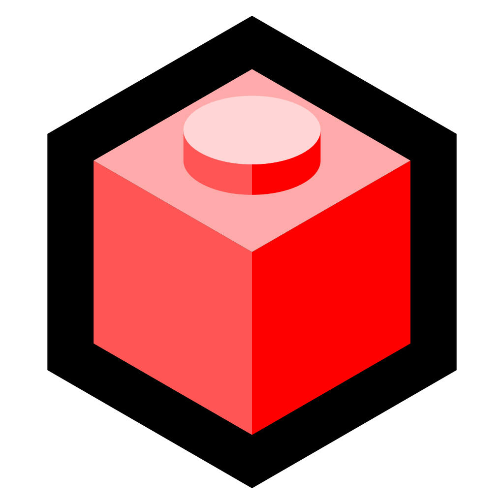

 <b>Custom LEGO® mecha MOCs</b> WHERE LEGO® MEETS OPEN SOURCE.

---

 
Show your appreciation with a PayPal donation!

---

 
Useful? Star the repository - it helps others find it.

---

### Welcome to [MechaBlocks](https://mechablocks.com)

This repository hosts the website dedicated to showcasing AFOL LEGO® models and their associated LDraw-based instructions.

---

### Credits:

MechaBlocks shows its models with [Three.js](https://github.com/mrdoob/three.js) by Ricardo Cabello and its contributors and [jQuery](https://github.com/jquery/jquery), with its scripts written for [GNU Bash](https://www.gnu.org/software/bash/). Models use parts from the [LDraw](https://www.ldraw.org) library and instructions come from [LPub3D](https://github.com/trevorsandy/lpub3d) by Trevor Sandy.

MechaBlocks is related to [StudWorx](https://github.com/nathaneltitane/studworx), the LDraw / LEGO® model builder behind every model, [L²CU](https://github.com/nathaneltitane/l2cu), the LDraw Linux command line utility that renders, exports and documents every model, and [Frobulator](https://github.com/nathaneltitane/frobulator), the shell scripting function library behind every MechaBlocks script.

---

### License:

MechaBlocks is free software released under the GNU General Public License version 3 - see 'LICENSE.md'.

LEGO® is a trademark of the LEGO® Group, which does not sponsor, authorize or endorse this project.

---

### Reports:

[Submit bug report or feature request](https://github.com/nathaneltitane/mechablocks/issues)

---

### Projects:

---

 
Show your appreciation with a PayPal donation!

---

 
Useful? Star the repository - it helps others find it.
